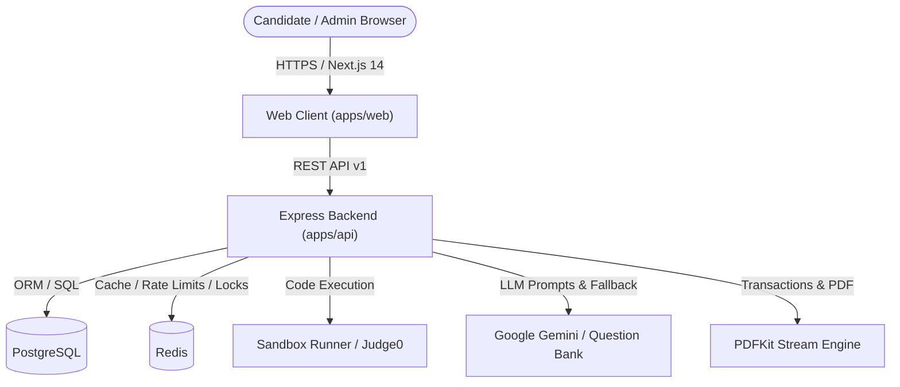

# AI Interview Preparation Platform

A production-grade, full-stack AI-assisted interview preparation and coding practice platform built with Next.js 14, Node.js + Express, PostgreSQL, Prisma, Redis, and sandboxed code execution.

[](https://github.com/anshumaan69/SDP-Interview/actions)
[](https://www.typescriptlang.org/)
[](https://nextjs.org/)
[](https://www.prisma.io/)

---

## 📚 Complete Engineering Documentation

The platform includes formal software engineering documentation conforming to IEEE/ISO/C4 standards:

- 📋 **[Software Requirements Specification (SRS)](file:///home/pikachu/Desktop/SDP-Interview/docs/SRS.md):** Full functional/non-functional requirements, user personas, and traceability matrix.
- 🏛️ **[High-Level Design (HLD)](file:///home/pikachu/Desktop/SDP-Interview/docs/HLD.md):** C4 architecture models (Context, Container, Component), subsystem design, and fallback topology.
- ⚙️ **[Low-Level Design (LLD)](file:///home/pikachu/Desktop/SDP-Interview/docs/LLD.md):** Class diagrams, services, adaptive algorithms, rubric math, and Redis keyspaces.
- 📊 **[UML & Architecture Diagrams](file:///home/pikachu/Desktop/SDP-Interview/docs/UML_DIAGRAMS.md):** 16 Mermaid diagrams (Use Cases, ERD, Sequence, State Machines, Activity, Deployment).
- 🗄️ **[Database Architecture & Data Dictionary](file:///home/pikachu/Desktop/SDP-Interview/docs/DATABASE_DESIGN.md):** Complete schema tables, indexes, cascades, and GDPR lifecycle.
- 🔌 **[REST API Specification](file:///home/pikachu/Desktop/SDP-Interview/docs/API_SPECIFICATION.md):** Detailed endpoint contracts, headers, payloads, and status codes.
- 🚀 **[DevOps & Deployment Runbook](file:///home/pikachu/Desktop/SDP-Interview/docs/DEPLOYMENT_AND_DEVOPS.md):** Docker Compose, CI/CD pipeline, monitoring, and production incident runbooks.
- 🧭 **[Documentation Hub & Index](file:///home/pikachu/Desktop/SDP-Interview/docs/README.md):** Central navigation portal.

---

## 1. Key Features

- **Adaptive Mock Interviews (MVP):** Synchronous first-question generation with fallback to curated question bank (230+ seeded questions across 8 roles and 4 interview types). Difficulty dynamically adapts (increases when consecutive scores $\ge 7.5$, decreases when $\le 4.0$).
- **Multi-Criteria Answer Evaluation:** In-depth scoring on Relevance, Correctness, Clarity, and Completeness, with constructive feedback and sample answers.
- **Curated Coding Practice (Judge0 Sandbox):** 30 curated data structure and algorithm challenges across Python, Java, and C++ with test cases, custom stdin testing, execution timeout (5s), 64KB output limits, and hidden test case confidentiality.
- **Candidate Analytics & History:** SQL-aggregated dashboard metrics, time-series progression charts, topic-specific radars, and session detail archives.
- **PDF Readiness Reports:** Server-side PDF generation via `pdfkit` featuring performance summaries, score breakdowns, strengths, weaknesses, and a 24-hour expiring signed download stream.
- **Admin Management & Moderation:** Platform KPIs, question bank CRUD with whitespace-normalized duplicate detection, bulk CSV question import with row failure reporting, user blocking/unblocking, and audit logging.
- **Enterprise-Grade Security:**
  - Bcrypt password hashing (cost 12)
  - 6-digit OTP verification stored in Redis (10-minute TTL, 3 attempt max, 60s cooldown)
  - 5-failure account lockout (15-minute cooldown in Redis)
  - Sliding session refresh token rotation (httpOnly, Secure, SameSite=Strict cookies)
  - Rate limiting (Auth: 10 req/min/IP; AI: 60/hr/user and 100/day/user)
  - GDPR-compliant account deletion (30-day purge grace period)

---

## 2. Architecture & Monorepo Structure



```
.
├── apps/
│   ├── api/                 # Express backend with TypeScript
│   │   ├── prisma/          # Prisma schema, migrations, seeders (230 questions, 30 problems)
│   │   ├── src/
│   │   │   ├── config/      # Environment schema & validation
│   │   │   ├── docs/        # Swagger OpenAPI 3.0 specification (/docs)
│   │   │   ├── jobs/        # Background maintenance & purge jobs
│   │   │   ├── middleware/  # Auth, validation, rate limiting, request-id, error handling
│   │   │   ├── routes/      # Auth, Me, Admin, Sessions, Dashboard, History, Reports, Coding
│   │   │   ├── services/    # Business logic & LLM fallback engines
│   │   │   └── tests/       # Jest integration test suites (55+ tests)
│   └── web/                 # Next.js 14 App Router with Tailwind CSS
│       └── src/
│           ├── app/         # (public), (candidate), (admin) route groups
│           ├── components/  # Navbar, UI elements, Toast, AI Disclaimer
│           └── lib/         # Typed API client with auto-refresh on 401
└── packages/
    └── shared/              # Shared Zod schemas, TypeScript enums, and API types
```

---

## 3. Technology Stack

| Layer | Technologies |
| --- | --- |
| **Frontend** | Next.js 14 (App Router), React 18, TypeScript, Tailwind CSS, Lucide Icons |
| **Backend API** | Node.js, Express, TypeScript, Zod, Pino Logger, Helmet, Swagger UI |
| **Database & Cache** | PostgreSQL 16, Prisma ORM, Redis 7 (ioredis) |
| **Code Execution** | Isolated child-process sandbox runner with Judge0 batch API compatibility |
| **AI & Reports** | Google Gemini Generative AI (with deterministic fallback), PDFKit |
| **Testing** | Jest, Supertest, ts-jest |

---

## 4. Getting Started

### Prerequisites

- Node.js >= 18.18.0
- `pnpm` >= 8 (or install via `npm i -g pnpm`)
- Docker & Docker Compose

### Step 1: Clone Repository

```bash
git clone https://github.com/anshumaan69/SDP-Interview.git
cd SDP-Interview
```

### Step 2: Start Infrastructure (PostgreSQL & Redis)

Start the required PostgreSQL and Redis containers:

```bash
docker compose up -d
```

> **Note:** PostgreSQL is mapped to port `5435` and Redis to port `6385` to avoid collisions with existing local daemons.

### Step 3: Install Dependencies

```bash
pnpm install
```

### Step 4: Database Push & Seeding

Sync the Prisma schema to PostgreSQL and seed default administrative credentials, 230+ curated questions, and 30 curated coding challenges:

```bash
pnpm --filter "@sdp/api" db:push
pnpm --filter "@sdp/api" db:seed
```

### Step 5: Start Development Servers

Run all workspaces concurrently (`web` on port 3000, `api` on port 4001):

```bash
pnpm dev
```

- Web Application: [http://localhost:3000](http://localhost:3000)
- API Base URL: [http://localhost:4001/api/v1](http://localhost:4001/api/v1)
- Swagger OpenAPI Docs: [http://localhost:4001/docs](http://localhost:4001/docs)

---

## 5. Seeded Accounts & Credentials

The seed script creates two pre-configured accounts for testing:

| Role | Email | Password | Access Capabilities |
| --- | --- | --- | --- |
| **Candidate** | `candidate@sdp.com` | `CandidatePass123!` | Mock Interviews, Coding Sandbox, Dashboard, History, PDF Reports |
| **Admin** | `admin@sdp.com` | `AdminPass123!` | User Moderation, Question Bank CRUD, Bulk CSV Upload, Audit Logs |

---

## 6. API Overview

| Route | Method | Description | Auth Required |
| --- | --- | --- | --- |
| `/health` | `GET` | Health check verifying PostgreSQL & Redis connectivity | None |
| `/meta/options` | `GET` | Predefined dropdown options (cached in Redis for 24h) | None |
| `/auth/register` | `POST` | Candidate registration with OTP generation | None |
| `/auth/verify-otp` | `POST` | Verification of 6-digit email OTP | None |
| `/auth/login` | `POST` | Login with JWT & sliding refresh cookie | None |
| `/auth/refresh` | `POST` | Rotate session refresh token | Refresh Cookie |
| `/me` | `GET`, `PATCH`, `DELETE` | Candidate profile management & account deletion | Candidate / Admin |
| `/admin/*` | Multiple | Stats, Question Bank CRUD, Bulk CSV Upload, Users, Audit Logs | Admin |
| `/sessions` | `POST`, `GET` | Create adaptive interview or list resumable loops | Candidate |
| `/sessions/:id/answers`| `POST` | Submit answer for evaluation (`Idempotency-Key` enabled) | Candidate |
| `/dashboard/summary` | `GET` | Aggregate candidate metrics | Candidate |
| `/reports` | `POST`, `GET` | Generate and list candidate PDF readiness reports | Candidate |
| `/coding/problems` | `GET` | Problem bank with solved status and difficulty counts | Candidate |
| `/coding/problems/:id/run` | `POST` | Run code against sample cases or custom stdin | Candidate |
| `/coding/problems/:id/submit` | `POST` | Submit solution against all hidden & sample cases | Candidate |

Visit [http://localhost:4001/docs](http://localhost:4001/docs) for the interactive Swagger documentation.

---

## 7. Running Test Suites

Run integration test suites covering Authentication, Admin, Mock Interviews, Dashboard Aggregates, Coding Sandbox, and Health checks:

```bash
# Run all API tests (55 passing tests)
pnpm --filter "@sdp/api" test

# Run typecheck across monorepo
pnpm typecheck

# Build all applications for production
pnpm build
```

---

## 8. License

Distributed under the MIT License. See `LICENSE` for more information.
