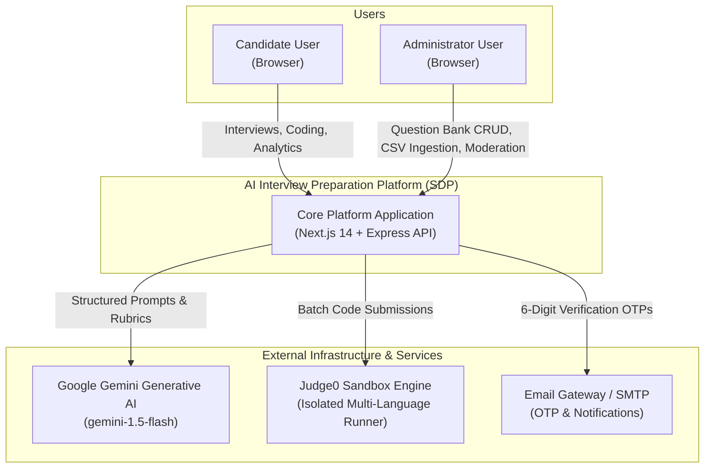

# High-Level Design (HLD) Document
## AI-Assisted Interview Preparation & Coding Practice Platform
**Document Identifier:** `SDP-HLD-2026-V2`  
**System Version:** 2.0.0  
**Status:** Approved / Production Architecture  

---

## 1. Architectural Goals & System Principles

The architecture of the **AI Interview Preparation Platform** is designed to satisfy the following core quality attributes:
1. **High Availability & Graceful Degradation:** The platform must continue providing adaptive mock interviews and coding execution even if third-party providers (Google Gemini or Judge0) experience downtime or rate-limit saturation.
2. **Strict Security Isolation:** Candidate code submitted in Python, Java, or C++ is fundamentally untrusted. Code execution must be isolated from the backend API host process with strict limits on CPU execution (5s), memory consumption (256MB), and I/O buffer (64KB).
3. **Low Latency & Immediate Interactivity:** Interview sessions must start immediately ($\le 2.5\text{s}$) with Question 1 ready. Subsequent questions are pre-generated asynchronously during candidate answer submission to eliminate mid-interview latency.
4. **Data Integrity & Auditability:** All financial, administrative, and authentication events must be backed by transactional ACID guarantees (PostgreSQL 16) and immutable audit trails. High-velocity ephemeral data (OTP codes, lockout counters, sliding rate limits) is delegated to in-memory Redis 7.
5. **Monorepo Cohesion:** A shared contract layer (`@sdp/shared`) guarantees that API schemas, validation rules, and TypeScript DTOs are synchronized across both frontend and backend without duplication.

---

## 2. System Architecture & C4 Model

### 2.1 C4 Level 1: System Context Diagram
The system context diagram illustrates the platform boundary, user roles, and external software dependencies.



---

### 2.2 C4 Level 2: Container Diagram
The container diagram illustrates the monorepo decomposition into runtime containers, data stores, and inter-process communication protocols.

```mermaid
flowchart TB
    Client["User Browser<br/>(React / Next.js Client)"]

    subgraph Frontend["Frontend Container (apps/web)"]
        NextApp["Next.js 14 App Router<br/>(Node 20 / Port 3000)<br/>- Server Components<br/>- Client Pages<br/>- Tailwind UI"]
    end

    subgraph Backend["API Gateway Container (apps/api)"]
        ExpressApp["Express.js REST Engine<br/>(Node 20 / Port 4001)<br/>- Middleware Pipeline<br/>- Domain Services<br/>- PDF Engine"]
    end

    subgraph DataStorage["Data & Cache Tier"]
        PostgresDB[("PostgreSQL 16<br/>(Port 5435)<br/>- Persistent Entities<br/>- Foreign Key Cascades")]
        RedisDB[("Redis 7<br/>(Port 6385)<br/>- OTP & Cooldowns<br/>- Lockout Tracking<br/>- Sliding Rate Limits")]
    end

    subgraph ExecutionTier["Code Execution Sandbox Tier"]
        Judge0Instance["Judge0 API Service<br/>(Port 2358)"]
        LocalSandbox["Isolated Process Runner<br/>(child_process.spawn fallback)"]
    end

    subgraph ExternalAI["External AI Tier"]
        GeminiAPI["Google Gemini 1.5 Flash<br/>(REST API)"]
    end

    Client -->|HTTPS / REST / Cookies| NextApp
    NextApp -->|Internal HTTP API v1| ExpressApp
    ExpressApp -->|Prisma ORM (Connection Pool)| PostgresDB
    ExpressApp -->|ioredis (TCP)| RedisDB
    ExpressApp -->|REST Submissions| Judge0Instance
    ExpressApp -.->|Fallback Execution| LocalSandbox
    ExpressApp -->|REST Prompting| GeminiAPI
```

---

### 2.3 C4 Level 3: API Component Architecture
The API server (`apps/api`) follows a modular layered architecture comprising Middleware, Routers, Domain Services, Data Access (Prisma/Redis), and Workers.

```mermaid
flowchart LR
    Request([Incoming HTTP Request]) --> MiddlewareLayer

    subgraph MiddlewareLayer["Middleware Pipeline"]
        ReqId["Request ID (UUID)"]
        RateLim["Rate Limiter (Redis)"]
        CorsHelmet["Helmet & CORS"]
        AuthMid["Auth Middleware (JWT)"]
        ValMid["Zod Request Validator"]
    end

    MiddlewareLayer --> RouterLayer

    subgraph RouterLayer["API Routers (/api/v1)"]
        R_Auth["auth.ts"]
        R_Sess["sessions.ts"]
        R_Code["coding.ts"]
        R_Dash["dashboard.ts"]
        R_Rep["reports.ts"]
        R_Adm["admin.ts"]
    end

    RouterLayer --> ServiceLayer

    subgraph ServiceLayer["Domain Services"]
        S_Auth["AuthService"]
        S_Int["InterviewService"]
        S_LLM["LlmService"]
        S_Code["CodingService"]
        S_Runner["CodeRunnerService"]
        S_Dash["DashboardService"]
        S_Rep["PdfReportService"]
        S_Adm["AdminService"]
    end

    subgraph DataAccess["Data Access & Persistence"]
        PrismaClient["Prisma ORM Client"]
        RedisClient["ioredis Client"]
    end

    ServiceLayer --> DataAccess
```



---

## 3. Technology Stack & Decision Matrix

| Architectural Layer | Chosen Technology | Evaluated Alternatives | Rationale & Justification |
| :--- | :--- | :--- | :--- |
| **Monorepo Engine** | `pnpm` workspaces | npm workspaces, Lerna, Nx | Fast symlink-based dependency resolution, strict package isolation, native workspace protocol (`workspace:*`). |
| **Frontend Framework** | Next.js 14 (App Router) | Vite + React SPA, Remix | Seamless Server/Client components, SSR for landing & terms, route groups `(public)`, `(candidate)`, `(admin)`, built-in layout management. |
| **Backend Framework** | Node.js + Express + TypeScript | NestJS, Fastify, Go Gin | Lightweight, universal middleware ecosystem (Pino, Helmet, CORS), zero boilerplate, maximum flexibility for custom stream handling (PDFKit). |
| **ORM & Database** | PostgreSQL 16 + Prisma ORM | TypeORM, Drizzle, MongoDB | Strict relational schema, ACID transactions for interview sessions and attempts, declarative schema migrations (`schema.prisma`), foreign key cascading. |
| **In-Memory Cache** | Redis 7 (via `ioredis`) | Memcached, In-memory Node Map | Atomic operations (`INCR`, `EXPIRE`), native key expiration for OTP (10m) and lockouts (15m), high-performance sliding rate-limiting counters. |
| **LLM Provider** | Google Gemini 1.5 Flash | OpenAI GPT-4o, Anthropic Claude | Sub-second inference latency, large context window, cost-effective structured JSON schema enforcement, zero cold-start delay. |
| **Code Sandbox** | Judge0 API + Local Isolated Process | Docker-in-Docker, AWS Lambda | Standardized batch execution protocol; local fallback ensures developer ergonomics and standalone deployment without requiring cloud infrastructure. |
| **Report Generation** | PDFKit | Puppeteer, HTML-to-PDF | Headless, zero Chromium dependency overhead, streaming PDF pipeline directly to HTTP response, predictable resource footprint. |
| **Validation Layer** | Zod (in `@sdp/shared`) | Joi, Yup, Class-Validator | Unified schema definition, automatic TypeScript type inference (`z.infer`), compile-time and runtime type safety across web and API. |

---

## 4. Core Subsystem Architectures

### 4.1 Identity, Access Management & Security Subsystem
The IAM subsystem guarantees zero unauthorized data access, implements OWASP recommendations, and provides enterprise session security:
1. **Registration & OTP Pipeline:**
   - User credentials validated against strict Zod schema (password entropy check: $\ge 8$ chars, digits, letters).
   - Password hashed using `bcrypt` (12 rounds).
   - Redis stores OTP hash with a strict 10-minute TTL and 3-attempt limit.
   - 60-second cooldown enforced via Redis key `otp_cooldown:<email>`.
2. **Session Security (Dual-Token Pattern):**
   - **Access Token:** Short-lived JWT (15-minute TTL) containing minimal claims (`userId`, `role`, `email`, `name`). Signed with `JWT_ACCESS_SECRET`.
   - **Refresh Token:** Cryptographically secure 40-byte random hex string. Hashed using SHA-256 before insertion into PostgreSQL `RefreshToken` table.
   - Transmitted to browser via HTTP-Only, Secure, `SameSite=Strict` cookie (`refreshToken`), preventing XSS exfiltration.
3. **Account Protection:**
   - 5 failed login attempts trigger an automatic 15-minute lockout via Redis key `lockout:<email>`, rejecting subsequent attempts with HTTP 423.
   - GDPR compliant soft-deletion: Candidate accounts marked for deletion enter a 30-day grace period; logging in within 30 days automatically reactivates the account. Expired accounts are permanently expunged via `purgeDeletedAccountsJob`.

---

### 4.2 Adaptive Mock Interview Subsystem
The interview engine powers real-time question generation, candidate evaluation, and difficulty adaptation.

```
       [Candidate Starts Interview]
                    |
                    v
    [Create Session: Status IN_PROGRESS]
                    |
                    v
     [Synchronous 1st Question Generation]
         |                          |
   (LLM Available)           (LLM Down / Timeout)
         |                          |
         v                          v
 [Gemini 1.5 Flash]       [Curated Question Bank]
         \                          /
          \                        /
           v                      v
        [Persist SessionQuestion 1]
                    |
                    v
         [Candidate Submits Answer]
                    |
                    v
     [Answer Persisted: Eval PENDING]
                    |
      +-------------+-------------+
      |                           |
      v                           v
(HTTP 202 Accepted)     (Asynchronous Evaluation)
                                  |
                                  v
                        [Score 4 Rubric Criteria]
                                  |
                                  v
                        [Compute Next Difficulty]
                                  |
                                  v
                        [Pre-generate Next Q]
```

#### Adaptive Difficulty Transition Matrix
The platform dynamically recalculates difficulty after each evaluated response based on the candidate's last two evaluated scores $(S_1, S_2)$:

| Current Difficulty | Evaluation Condition | Next Difficulty | Action Taken |
| :--- | :--- | :--- | :--- |
| `EASY` | $S_1 \ge 7.5 \land S_2 \ge 7.5$ | `MEDIUM` | Difficulty Escalation (+1) |
| `EASY` | Any other combination | `EASY` | Maintain Difficulty (0) |
| `MEDIUM` | $S_1 \ge 7.5 \land S_2 \ge 7.5$ | `HARD` | Difficulty Escalation (+1) |
| `MEDIUM` | $S_1 \le 4.0 \land S_2 \le 4.0$ | `EASY` | Difficulty De-escalation (-1) |
| `MEDIUM` | Any other combination | `MEDIUM` | Maintain Difficulty (0) |
| `HARD` | $S_1 \le 4.0 \land S_2 \le 4.0$ | `MEDIUM` | Difficulty De-escalation (-1) |
| `HARD` | Any other combination | `HARD` | Maintain Difficulty (0) |

---

### 4.3 Sandboxed Code Execution Subsystem
The coding subsystem guarantees deterministic, secure execution of untrusted user-submitted code in competitive programming environments.

#### Execution Pipeline Architecture
1. **Primary Route (Judge0 Batch Engine):** When `JUDGE0_URL` is accessible, the backend bundles all test cases into a batch payload (`POST /submissions/batch`), polls for execution status, and maps Judge0 status codes (3: Accepted, 5: TLE, 6: Compilation Error, $\ge 7$: Runtime Error).
2. **Resilience Fallback (Isolated Child-Process Runner):**
   - The engine automatically switches to local isolated child process execution if Judge0 is offline.
   - Dedicated temporary directory created per execution (`/tmp/sdp_code_XXXXXX`).
   - Compilation step for C++ (`g++ -O2`) and Java (`javac`) executed with a 5-second compilation limit.
   - Execution step runs `python3`, `java`, or compiled binary with standard input piped via Node streams.
   - Strict 5000 ms process timeout enforced via `setTimeout` and `process.kill("SIGKILL")`.
   - Output truncated at 64 KB to defend against infinite loop stdout flooding attacks.
   - Automatic `rm -rf` cleanup of temporary workspaces in a `finally` block.
3. **Data Privacy Guard:** Candidate-facing endpoints (`GET /coding/problems/:id` and `POST /coding/problems/:id/run`) strictly omit hidden test cases (`isHidden = true`). Hidden test cases are exclusively evaluated on server-side solution submission (`POST /coding/problems/:id/submit`).

---

### 4.4 Analytics & PDF Reporting Subsystem
1. **SQL-Driven Aggregations:** Summary statistics, historical time-series progression curves, and radar distributions are calculated via optimized PostgreSQL queries utilizing composite indexes on `(userId, createdAt)` and `(userId, status)`.
2. **Server-Side PDF Streaming Engine:**
   - Candidate clicks "Generate Readiness Report".
   - Backend enqueues a `Report` record (`status = QUEUED`).
   - `PdfReportService` compiles candidate interview records, score averages, strengths, weaknesses, and recent sessions.
   - Streams PDF generation through `pdfkit` into `reports/generated/report_<uuid>.pdf`.
   - Signed download stream endpoint (`GET /api/v1/reports/:id/download`) verifies user ownership and streams file binary with `Content-Type: application/pdf` and `Content-Disposition: attachment`.
   - Report links expire after 24 hours.

---

### 4.5 Administrative Management & Governance Subsystem
1. **Platform Analytics:** Real-time KPI metrics aggregated across candidate accounts, completed interview sessions, question repository counts, and daily session throughput.
2. **Question Bank Deduplication:** All questions entered manually or imported via CSV undergo canonical text normalization:
   $$\text{normalize}(T) = \text{strip}(\text{lowercase}(\text{regex\_replace}(T, \text{"\s+"}, \text{" "}))) $$
   Database uniqueness is enforced via index on `Question.normalizedText`.
3. **Bulk CSV Ingestion Engine:**
   - Ingests multipart CSV uploads.
   - Verifies header specification: `text, type, role, difficulty, idealAnswer`.
   - Parses each row independently; syntax or schema failures are collected into an itemized failure array with row numbers and exact rejection reasons without aborting valid rows.
4. **User Governance & Moderation:** Administrators can block malicious or abusive candidate accounts. The middleware intercepts blocked users at the JWT verification phase, rejecting further activity immediately.

---

## 5. Security & Threat Mitigation Architecture

| Threat / Attack Vector | Mitigation Strategy & Implementation | Verification Method |
| :--- | :--- | :--- |
| **Credential Stuffing & Brute Force** | 5 consecutive failed attempts trigger a 15-minute Redis lockout. Authentication rate limit: 10 req/min/IP. | Integration Test (`auth.test.ts`) |
| **Session Hijacking / XSS** | Refresh tokens stored in `HttpOnly`, `Secure`, `SameSite=Strict` cookies. Short-lived (15 min) JWT access tokens. | Cookie Header Analysis |
| **Denial of Service (DoS) on LLM** | Tiered rate limiters: 60 req/hr/user and 100 req/day/user on interview endpoints. | Rate Limiter Middleware |
| **Arbitrary Code Execution / Fork Bomb** | Isolated child-process sandbox, 5s hard CPU timeout, 64KB I/O buffer limit, temporary isolated filesystem, network restrictions. | Coding Integration Test (`coding.test.ts`) |
| **SQL Injection (SQLi)** | 100% parameterized queries via Prisma ORM; zero raw string concatenation in database interactions. | Code Review & Static Analysis |
| **Cross-Site Request Forgery (CSRF)** | `SameSite=Strict` cookie policy, JSON content-type requirement for mutation endpoints, Bearer token authorization for data routes. | OWASP Testing Protocol |
| **Replay Attacks on Answer Submission** | Mandatory or optional `Idempotency-Key` header with database unique constraints (`Answer.idempotencyKey`). | Idempotency Test Suites |

---

## 6. High Availability & Disaster Recovery

```
                      +-----------------------------+
                      |   Incoming User Activity    |
                      +--------------+--------------+
                                     |
                     +---------------v---------------+
                     |   System Operational Mode     |
                     +---------------+---------------+
                                     |
               +---------------------+---------------------+
               |                                           |
               v                                           v
    [Third-Party Service OK]                   [Third-Party Degradation]
               |                                           |
   +-----------+-----------+                   +-----------+-----------+
   | Gemini LLM: Online   |                   | Gemini LLM: Offline   |
   | Judge0 Sandbox: Online|                   | Judge0 Sandbox: Offline|
   +-----------+-----------+                   +-----------+-----------+
               |                                           |
               v                                           v
    Full Generative Experience                 Seamless Fallback Experience
    - AI-generated novel questions              - 230+ Curated Question Bank
    - Dynamic rubric evaluations                - Offline Rule-Based Scoring
    - Multi-language Judge0 execution           - Isolated Local Sandbox Runner
```

1. **Two-Tier LLM Fallback:** If Gemini API fails twice or exceeds 2.5 seconds, the engine automatically selects a validated question from the 230+ seeded Question Bank matching candidate role, type, and difficulty, excluding questions from the user's past 5 sessions.
2. **Two-Tier Code Execution Fallback:** If Judge0 API is unreachable, the engine automatically routes compilation and execution to the local isolated child-process runner (`codeRunnerService.ts`).
3. **Database & Cache Health Check:** The `/health` endpoint periodically pings PostgreSQL via `prisma.$queryRaw` and Redis via `redis.ping()`, exposing real-time service health to orchestrators (Docker, Kubernetes).
