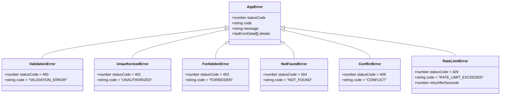

# Low-Level Design (LLD) Document
## AI-Assisted Interview Preparation & Coding Practice Platform
**Document Identifier:** `SDP-LLD-2026-V2`  
**System Version:** 2.0.0  
**Status:** Approved / Technical Implementation Specification  

---

## 1. Codebase Architecture & Directory Layout

The platform is organized as a monorepo managed by `pnpm` workspaces (`pnpm-workspace.yaml`).

```
.
├── apps/
│   ├── api/                          # Express.js REST API application
│   │   ├── prisma/
│   │   │   ├── schema.prisma         # Data models, enums, indexes, and relations
│   │   │   ├── seed.ts               # Database bootstrap orchestrator
│   │   │   ├── seedQuestions.ts      # 230+ curated questions seeder
│   │   │   └── seedProblems.ts       # 30 curated coding challenges seeder
│   │   └── src/
│   │       ├── config/
│   │       │   └── env.ts            # Environment variables loader & validator
│   │       ├── docs/
│   │       │   └── swagger.ts        # OpenAPI 3.0 specification & Swagger UI router
│   │       ├── jobs/
│   │       │   └── purgeAccountsJob.ts # Scheduled GDPR 30-day account cleanup
│   │       ├── lib/
│   │       │   ├── errors.ts         # Custom AppError hierarchy
│   │       │   ├── logger.ts         # Pino logger configuration
│   │       │   ├── prisma.ts         # Singleton PrismaClient instance
│   │       │   └── redis.ts          # Singleton ioredis instance
│   │       ├── middleware/
│   │       │   ├── auth.ts           # JWT extraction & candidate verification
│   │       │   ├── errorHandler.ts   # Centralized HTTP error handler
│   │       │   ├── rateLimiter.ts    # Redis-backed sliding counter rate limiter
│   │       │   ├── requestId.ts      # UUID request correlation injection
│   │       │   ├── requireRole.ts    # RBAC authorization guard
│   │       │   └── validate.ts       # Zod schema request payload validator
│   │       ├── routes/
│   │       │   ├── admin.ts          # Admin portal routes
│   │       │   ├── auth.ts           # Registration, OTP, login, refresh routes
│   │       │   ├── coding.ts         # Problems, run code, submit routes
│   │       │   ├── dashboard.ts      # Summary & trend analytics routes
│   │       │   ├── health.ts         # Service readiness & health routes
│   │       │   ├── history.ts        # Candidate session archives routes
│   │       │   ├── me.ts             # Profile management & deletion routes
│   │       │   ├── meta.ts           # Predefined dropdown metadata routes
│   │       │   ├── reports.ts        # PDF report queue & streaming download routes
│   │       │   └── sessions.ts       # Interview lifecycle & answer evaluation routes
│   │       ├── services/
│   │       │   ├── admin/adminService.ts       # Admin business logic
│   │       │   ├── auth/authService.ts         # Authentication & security logic
│   │       │   ├── coding/
│   │       │   │   ├── codingService.ts        # Coding challenges domain service
│   │       │   │   └── codeRunnerService.ts    # Judge0 / Isolated sandbox runner
│   │       │   ├── dashboard/dashboardService.ts # Analytics aggregation service
│   │       │   ├── email/emailProvider.ts      # Nodemailer SMTP transport
│   │       │   ├── interview/interviewService.ts # Adaptive interview engine
│   │       │   ├── llm/llmService.ts           # Gemini prompt & fallback engine
│   │       │   └── report/pdfReportService.ts  # PDFKit document generator
│   │       ├── app.ts                # Express app configuration & middleware binding
│   │       └── server.ts             # HTTP server entrypoint
│   └── web/                          # Next.js 14 App Router frontend
│       └── src/
│           ├── app/
│           │   ├── (public)/         # Landing, login, signup, OTP, reset, terms
│           │   ├── (candidate)/      # Interview, coding, dashboard, history, reports
│           │   └── (admin)/          # Admin stats, questions, users, audit logs
│           ├── components/           # Reusable UI components (Navbar, Toast, Disclaimer)
│           └── lib/                  # Fetch client with auto-refresh interceptor
└── packages/
    └── shared/                       # Shared domain contracts & validation
        └── src/
            ├── enums.ts              # System enums (Role, Difficulty, SessionStatus, etc.)
            ├── schemas.ts            # Zod validation schemas & inferred types
            └── types.ts              # API response envelopes & DTOs
```

---

## 2. Service & Class Specifications

### 2.1 AuthService (`services/auth/authService.ts`)
Responsible for candidate registration, credential security, OTP verification, JWT session issuance, refresh token rotation, lockout handling, and GDPR deletion.

```typescript
export class AuthService {
  // Registers a new user, hashes password (bcrypt cost 12), creates User record, dispatches 6-digit OTP
  async register(input: RegisterInput): Promise<{ userId: string; email: string }>;

  // Generates 6-digit OTP, stores hash in Redis with 10-minute TTL, enforces 60s cooldown
  async sendVerificationOtp(email: string): Promise<void>;

  // Validates OTP against Redis, tracks failed attempts (max 3), updates emailVerified = true
  async verifyOtp(input: VerifyOtpInput): Promise<{ verified: boolean }>;

  // Resends OTP respecting 60-second cooldown in Redis
  async resendOtp(email: string): Promise<void>;

  // Authenticates credentials, verifies status, enforces 5-strike lockout, issues JWT and sliding refresh cookie
  async login(input: LoginInput, ip?: string): Promise<{
    user: UserSummary;
    accessToken: string;
    refreshTokenPlain: string;
  }>;

  // Rotates refresh token: revokes old token, generates new token with 30m sliding expiry, issues new JWT
  async refreshToken(oldTokenPlain: string): Promise<{
    accessToken: string;
    refreshTokenPlain: string;
  }>;

  // Revokes refresh token in database
  async logout(refreshTokenPlain?: string): Promise<void>;

  // Initiates password reset by issuing single-use token
  async forgotPassword(email: string): Promise<void>;

  // Resets password using valid unexpired token
  async resetPassword(input: ResetPasswordInput): Promise<void>;

  // Soft-deletes user account by setting markedForDeletionAt = NOW()
  async deleteAccount(userId: string, input: DeleteAccountInput): Promise<void>;
}
```

---

### 2.2 InterviewService (`services/interview/interviewService.ts`)
Orchestrates adaptive mock interview lifecycles, question generation, answer submissions, difficulty adaptation, and summary generation.

```typescript
export class InterviewService {
  // Creates Session record (IN_PROGRESS), synchronously generates Q1 (via Gemini or Bank), returns session state
  async createSession(userId: string, input: CreateSessionInput): Promise<SessionStartDto>;

  // Retrieves active session state, current question index, and current question text
  async getSession(userId: string, sessionId: string): Promise<SessionDetailsDto>;

  // Lists resumable sessions (IN_PROGRESS or PAUSED) for candidate
  async getResumableSessions(userId: string): Promise<Session[]>;

  // Accepts candidate answer, records Answer (PENDING), triggers async evaluation, supports Idempotency-Key
  async submitAnswer(
    userId: string,
    sessionId: string,
    input: SubmitAnswerInput,
    idempotencyKey?: string
  ): Promise<{ answerId: string; evalStatus: EvalStatus }>;

  // Internal evaluation worker: calls LLM rubric, computes next difficulty, pre-generates next question
  async processAnswerEvaluation(sessionId: string, sessionQuestionId: string, answerId: string): Promise<void>;

  // Polls evaluation status; when DONE, returns scores, feedback, sample answer, and next question
  async getAnswerEvaluation(userId: string, sessionId: string, answerId: string): Promise<AnswerEvaluationResult>;

  // Skips current question: assigns score 0, advances index, pre-generates next question
  async skipQuestion(userId: string, sessionId: string, questionId: string): Promise<SkipResultDto>;

  // Pauses session (status = PAUSED)
  async pauseSession(userId: string, sessionId: string): Promise<{ status: SessionStatus }>;

  // Resumes paused session (status = IN_PROGRESS)
  async resumeSession(userId: string, sessionId: string): Promise<SessionDetailsDto>;

  // Ends session early or on completion, triggers aggregate metrics and summary suggestions
  async endSession(userId: string, sessionId: string): Promise<SessionResultDto>;

  // Retrieves completed session results, rubric averages, strengths, weaknesses, and question breakdowns
  async getSessionResult(userId: string, sessionId: string): Promise<SessionResultDto>;
}
```

---

### 2.3 LlmService (`services/llm/llmService.ts`)
Encapsulates Google Gemini 1.5 Flash communication, structured JSON output validation, and deterministic Question Bank fallback.

```typescript
export class LlmService {
  // Generates interview question using Gemini with 2 retries; excludes questions from past 5 sessions
  async generateQuestion(params: {
    userId: string;
    role: string;
    type: InterviewType;
    difficulty: Difficulty;
    excludedQuestionTexts?: string[];
  }): Promise<{ text: string; idealAnswer?: string; isFallback: boolean }>;

  // Fallback selector: queries Question Bank with multi-tier relaxation strategy
  async pickFallbackQuestion(
    role: string,
    type: InterviewType,
    difficulty: Difficulty,
    excluded: Set<string>
  ): Promise<{ text: string; idealAnswer?: string; isFallback: boolean }>;

  // Evaluates answer on Relevance, Correctness, Clarity, Completeness (0-10) using Gemini or offline rubric
  async evaluateAnswer(params: {
    questionText: string;
    answerText: string;
    role: string;
    difficulty: Difficulty;
    idealAnswer?: string | null;
  }): Promise<EvaluatedAnswerResult>;

  // Offline deterministic fallback evaluator based on substance, structure, and length
  mockEvaluateAnswer(questionText: string, answerText: string, idealAnswer?: string | null): EvaluatedAnswerResult;

  // Generates qualitative session summary: strengths, weak areas, and actionable improvement recommendations
  async generateSessionSummary(params: {
    role: string;
    type: InterviewType;
    qnaList: Array<{ question: string; answer: string; score: number }>;
  }): Promise<{ strengths: string[]; weakAreas: string[]; suggestions: string[] }>;
}
```

---

### 2.4 CodingService & CodeRunnerService (`services/coding/`)
Implements problem retrieval, safe execution against visible/hidden test cases, and sandboxing.

```typescript
export class CodingService {
  // Aggregates coding topics and counts by difficulty (EASY, MEDIUM, HARD)
  async getTopics(): Promise<CodingTopicSummary[]>;

  // Lists paginated problems with solved status and attempt counts for candidate
  async getProblems(userId: string, params: CodingProblemsQueryParams): Promise<PaginatedProblemsDto>;

  // Picks random problem matching topic/difficulty, prioritizing unsolved challenges
  async getRandomProblem(userId: string, topic?: string, difficulty?: string): Promise<CodingProblemDto>;

  // Retrieves problem details (strictly omits isHidden = true test cases)
  async getProblemById(idOrSlug: string, userId: string): Promise<CodingProblemDto>;

  // Runs code against visible sample cases or custom input in isolated sandbox
  async runCode(userId: string, problemId: string, input: RunCodeInput): Promise<RunCodeResultDto>;

  // Submits solution against all sample and hidden test cases, records CodingAttempt, determines verdict
  async submitCode(
    userId: string,
    problemId: string,
    input: SubmitCodeInput,
    idempotencyKey?: string
  ): Promise<CodingAttemptDto>;
}

export class CodeRunnerService {
  // Orchestrates batch test case execution via Judge0 or fallback isolated child-process
  async runBatch(
    language: CodingLanguage,
    code: string,
    cases: TestCaseExecution[]
  ): Promise<{ passedCount: number; total: number; compileError?: string; results: ExecutionResult[] }>;

  // Local sandbox runner: isolated temp directory, 5s timeout, 64KB output limit, compilation for C++/Java
  private async runInIsolatedSandbox(
    language: CodingLanguage,
    code: string,
    cases: TestCaseExecution[]
  ): Promise<BatchExecutionResult>;

  // Process executor wrapping child_process.spawn with timeout kill and buffer truncation
  private async executeProcess(
    cmd: string,
    args: string[],
    input: string,
    timeoutMs: number
  ): Promise<{ stdout: string; stderr: string; exitCode: number; timedOut: boolean; runtimeMs: number }>;
}
```

---

### 2.5 DashboardService & PdfReportService
```typescript
export class DashboardService {
  // Computes aggregate candidate KPIs: total sessions, completed sessions, average score, best score
  async getSummary(userId: string, from?: string, to?: string): Promise<DashboardSummaryDto>;

  // Groups interview performance over time by day or week
  async getTrend(userId: string, from?: string, to?: string, granularity?: "day" | "week"): Promise<TrendPointDto[]>;
}

export class PdfReportService {
  // Enqueues a PDF readiness report generation task
  async queueReport(userId: string, from?: string, to?: string): Promise<{ reportId: string; status: ReportStatus }>;

  // Generates multi-page PDF readiness report using PDFKit and saves to disk
  async generatePdf(reportId: string): Promise<void>;

  // Verifies candidate ownership and streams PDF binary with expiring headers
  async getReportStream(reportId: string, userId: string): Promise<fs.ReadStream>;
}
```

---

### 2.6 AdminService (`services/admin/adminService.ts`)
```typescript
export class AdminService {
  // Retrieves platform KPIs: total candidates, active candidates, total sessions, sessions today
  async getStats(): Promise<AdminStatsDto>;

  // Paginated and filtered question bank search
  async getQuestions(params: AdminQuestionsQueryParams): Promise<PaginatedQuestionsDto>;

  // Creates new question with normalized duplicate collision check and audit logging
  async createQuestion(input: CreateQuestionInput, adminId: string, ip?: string): Promise<Question>;

  // Updates question with duplicate collision check
  async updateQuestion(id: string, input: UpdateQuestionInput, adminId: string, ip?: string): Promise<Question>;

  // Deletes question from repository with audit logging
  async deleteQuestion(id: string, adminId: string, ip?: string): Promise<void>;

  // Bulk ingests CSV question rows with row-level error reporting
  async bulkUploadQuestions(csvContent: string, adminId: string, ip?: string): Promise<BulkUploadResultDto>;

  // Searches candidates and modifies user status (ACTIVE / BLOCKED)
  async updateUserStatus(userId: string, status: UserStatus, adminId: string, ip?: string): Promise<User>;

  // Queries immutable platform audit logs
  async getAuditLogs(params: AuditLogsQueryParams): Promise<PaginatedAuditLogsDto>;
}
```

---

## 3. Algorithmic Specifications & Mathematical Formulations

### 3.1 Adaptive Difficulty Algorithm
The function `computeNextDifficulty(current, lastTwoScores)` operates as a finite-state machine over the state set $\mathcal{S} = \{\text{EASY}, \text{MEDIUM}, \text{HARD}\}$.

```
                  +----------------------------------------+
                  |                                        |
                  v                                        | (s1 >= 7.5 && s2 >= 7.5)
              +-------+       (s1 >= 7.5 && s2 >= 7.5)  +--------+
              | EASY  | ------------------------------> | MEDIUM |
              +-------+ <------------------------------ +--------+
                  ^           (s1 <= 4.0 && s2 <= 4.0)     |
                  |                                        | (s1 >= 7.5 && s2 >= 7.5)
                  |                                        v
                  |                                     +------+
                  |           (s1 <= 4.0 && s2 <= 4.0)  | HARD |
                  +------------------------------------ +------+
```

#### Mathematical Definition:
Let $S = (s_1, s_2)$ be the tuple of candidate overall scores for the most recent two answered questions, where $s_i \in [0.0, 10.0]$.

$$\delta(D, S) = 
\begin{cases} 
\min(D + 1, \text{HARD}) & \text{if } s_1 \ge 7.5 \land s_2 \ge 7.5 \\
\max(D - 1, \text{EASY}) & \text{if } s_1 \le 4.0 \land s_2 \le 4.0 \\
D & \text{otherwise}
\end{cases}$$

Where difficulty levels are mapped: $\text{EASY} = 0, \text{MEDIUM} = 1, \text{HARD} = 2$.

---

### 3.2 Evaluation Score Aggregation
For each submitted answer, four criteria are scored independently:
1. $R \in [0.0, 10.0]$: Relevance
2. $C_{orr} \in [0.0, 10.0]$: Correctness
3. $C_{lar} \in [0.0, 10.0]$: Clarity
4. $C_{omp} \in [0.0, 10.0]$: Completeness

The individual answer score $S_k$ is the unweighted arithmetic mean:
$$S_k = \text{round}\left(\frac{R + C_{orr} + C_{lar} + C_{omp}}{4}, 1\right)$$

For completed sessions with $N$ questions, where $M \le N$ questions were non-skipped ($Q_{answered}$):
$$\bar{S}_{session} = \frac{1}{|Q_{answered}|} \sum_{k \in Q_{answered}} S_k$$
Skipped questions receive $S_k = 0.0$ and are excluded from the candidate's average calculation to prevent unfairly distorting mastery scores.

---

### 3.3 Question Normalization & Deduplication
To prevent duplicate questions caused by trivial formatting differences, the function `normalizeQuestionText(T)` executes:
$$\text{normalize}(T) = \text{regex\_replace}(\text{trim}(\text{lowercase}(T)), \text{"\s+"}, \text{" "})$$

A query against `Question.normalizedText` ensures uniqueness across the entire platform repository.

---

### 3.4 Sliding Counter Rate Limiting Algorithm
The rate limiter middleware uses Redis atomic primitives (`INCR` and `EXPIRE`) to enforce per-window quotas.

```typescript
const redisKey = `ratelimit:${keyPrefix}:${identifier}`;
const current = await redis.incr(redisKey);
if (current === 1) {
  await redis.expire(redisKey, windowSeconds);
}
if (current > maxRequests) {
  throw new RateLimitError(`Rate limit exceeded: max ${maxRequests} requests per ${windowSeconds}s`, windowSeconds);
}
```

---

## 4. Error Handling Framework & Exception Taxonomy

All application exceptions inherit from `AppError` in `apps/api/src/lib/errors.ts`.



### Standardized Error Response Envelope:
```json
{
  "error": {
    "code": "VALIDATION_ERROR",
    "message": "Invalid request payload",
    "details": [
      {
        "field": "email",
        "issue": "Invalid email address"
      }
    ]
  }
}
```

---

## 5. Middleware Pipeline Execution Order

```
[Incoming Request]
        |
        v
[1. requestId] -------------> Injects X-Request-Id (UUID v4) into req and res headers
        |
        v
[2. helmet & cors] ---------> Sets secure HTTP headers and validates allowed CORS origins
        |
        v
[3. cookieParser] ----------> Parses HTTP-Only cookies (extracts refreshToken)
        |
        v
[4. express.json] ----------> Parses incoming JSON payloads (max 10MB)
        |
        v
[5. rateLimiter] -----------> Evaluates Redis sliding rate limit counters
        |
        v
[6. auth] ------------------> Extracts Bearer JWT, validates signature, hydrates req.user
        |
        v
[7. requireRole] -----------> Enforces RBAC permissions (CANDIDATE vs ADMIN)
        |
        v
[8. validate(schema)] ------> Validates req.body, req.query, or req.params via Zod
        |
        v
[Route Handler]
        |
        v
[9. errorHandler] ----------> Intercepts AppError, maps status code, formats JSON response
```

---

## 6. Redis Keyspace Catalog

| Key Pattern | Redis Type | TTL | Purpose / Value Schema |
| :--- | :--- | :--- | :--- |
| `otp:<email>` | `STRING` | 600s (10 min) | `{"hash": "<bcrypt_hash>", "attempts": <int>}` |
| `otp_cooldown:<email>` | `STRING` | 60s (1 min) | `"1"` (resend throttler) |
| `failed_login:<email>` | `STRING` | 900s (15 min) | Integer count of consecutive incorrect passwords |
| `lockout:<email>` | `STRING` | 900s (15 min) | `"1"` (locks account from authentication) |
| `ratelimit:<prefix>:<id>` | `STRING` | Variable | Integer count of requests within time window |
| `meta:options` | `STRING` | 86400s (24h) | Predefined JSON metadata options (roles, types, etc.) |
