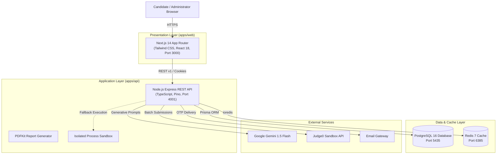

# AI Interview Preparation Platform — Documentation Hub
**System Version:** 2.0.0  
**Status:** Complete Production Engineering Documentation Baseline  
**Workspace:** `SDP-Interview`  

---

## 1. Documentation Index

Welcome to the engineering documentation suite for the **AI Interview Preparation Platform**. This repository contains complete specifications, system designs, architectural models, and operational runbooks compliant with industry software engineering standards (IEEE 830, ISO/IEC 29148, IEEE 1016, and UML 2.5).

| Document | File Path | Standard / Description |
| :--- | :--- | :--- |
| **Software Requirements Specification (SRS)** | [SRS.md](./SRS.md) | IEEE 830 / ISO/IEC/IEEE 29148 standard specification detailing functional requirements (`FR-AUTH`, `FR-INT`, `FR-CODE`, `FR-DASH`, `FR-ADM`), user personas, non-functional requirements (NFRs), and traceability matrix. |
| **High-Level Design (HLD)** | [HLD.md](./HLD.md) | C4 architectural models (Context, Container, Component), technology stack selection, subsystem decompositions, network topology, threat modeling, and fault-tolerance fallback architectures. |
| **Low-Level Design (LLD)** | [LLD.md](./LLD.md) | Detailed class and interface specifications, algorithmic formulations (adaptive difficulty transitions, rubric scoring aggregation, question deduplication), error taxonomy, and Redis keyspace catalog. |
| **UML Diagrams Suite** | [UML_DIAGRAMS.md](./UML_DIAGRAMS.md) | 16 comprehensive Mermaid diagrams: Use Case, System Context, ERD, Detailed Class Diagrams, Sequence Diagrams (Auth, Sessions, Coding, PDF, CSV), State Machines, and Deployment Topology. |
| **Database & Data Architecture** | [DATABASE_DESIGN.md](./DATABASE_DESIGN.md) | Complete Entity-Relationship model, comprehensive Data Dictionary for all 13 Prisma tables and 10 enums, indexing strategies, referential cascading rules, and 30-day GDPR deletion lifecycle. |
| **REST API Specification** | [API_SPECIFICATION.md](./API_SPECIFICATION.md) | OpenAPI-aligned reference for all endpoints across Auth, Profile, Sessions, Answers, Coding Sandbox, Analytics, PDF Reports, and Admin Portals with request/response schemas. |
| **Deployment & DevOps Runbook** | [DEPLOYMENT_AND_DEVOPS.md](./DEPLOYMENT_AND_DEVOPS.md) | Containerization with Docker Compose, environment configuration matrix, monorepo build pipeline, CI/CD GitHub Actions workflow, logging, health monitoring, and incident runbooks. |

---

## 2. High-Level Architecture Snapshot

---

## 3. Core System Highlights

1. **Adaptive Interview Engine:**
   - Synchronous first question generation ($\le 2.5\text{s}$) with automated fallback to 230+ curated questions.
   - Dynamic difficulty adaptation based on candidate performance: consecutive scores $\ge 7.5$ increase difficulty; scores $\le 4.0$ decrease difficulty.
   - Multi-criteria answer evaluation (Relevance, Correctness, Clarity, Completeness) with constructive feedback and model answers.
2. **Competitive Coding Sandbox:**
   - 30 curated data structures and algorithms challenges across Python 3, Java, and C++.
   - Judge0 batch API integration with automatic fallback to a local isolated child-process runner.
   - Hard 5000 ms CPU timeout, 64KB I/O buffer limit, and hidden test case confidentiality.
3. **Analytics & PDF Readiness Reports:**
   - Real-time SQL aggregations for dashboard metrics and daily/weekly score progression curves.
   - Headless server-side PDF generation via `pdfkit` streamed directly to the candidate with 24-hour expiring signed download links.
4. **Enterprise Security & Administration:**
   - Bcrypt password hashing (cost 12), 6-digit OTP verification with 10-minute TTL and 3-attempt limit.
   - 5-strike account lockout (15-minute cooldown in Redis) and sliding refresh token rotation (`httpOnly`, `Secure`, `SameSite=Strict` cookies).
   - Rate limiting across authentication (10 req/min/IP) and AI endpoints (60/hr/user, 100/day/user).
   - Question bank CRUD with normalized duplicate detection, bulk CSV upload with row-level error reporting, and immutable audit logs.

---

## 4. Quick Navigation Links

- [Read the SRS (Requirements Specification)](./SRS.md)
- [Read the HLD (High-Level Architecture)](./HLD.md)
- [Read the LLD (Low-Level Implementation)](./LLD.md)
- [Inspect all UML & Architectural Diagrams](./UML_DIAGRAMS.md)
- [Review Database Schema & Data Dictionary](./DATABASE_DESIGN.md)
- [Browse REST API Documentation](./API_SPECIFICATION.md)
- [Review DevOps, Deployment & Incident Runbooks](./DEPLOYMENT_AND_DEVOPS.md)
