# Complete UML & Architectural Diagrams Suite
## AI-Assisted Interview Preparation & Coding Practice Platform
**Document Identifier:** `SDP-UML-2026-V2`  
**System Version:** 2.0.0  
**Specification:** Unified Modeling Language (UML 2.5) & C4 Model  

---

## 1. System Use Case Diagram

The use case diagram illustrates the interactions between primary human actors (**Candidate**, **Administrator**, **Guest User**) and external systems (**Google Gemini AI**, **Judge0 Engine**, **SMTP Gateway**).

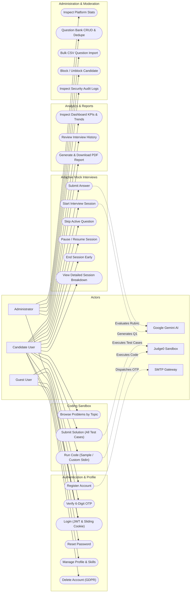

---

## 2. System Context & Container Diagram (C4 Model)

```mermaid
flowchart TB
    subgraph Clients["Presentation Tier"]
        Browser["Candidate / Admin Browser<br/>(HTTPS)"]
    end

    subgraph AppServer["Application Tier (Node.js & Express)"]
        NextWeb["Web Client App (apps/web)<br/>Next.js 14 App Router<br/>Port 3000"]
        API["Backend API Gateway (apps/api)<br/>Express.js / TypeScript<br/>Port 4001"]
    end

    subgraph DataTier["Data & Cache Tier"]
        Postgres[("PostgreSQL 16 DB<br/>Port 5435<br/>Relational Store")]
        RedisStore[("Redis 7 Store<br/>Port 6385<br/>OTP / Rate Limits / Lockout")]
    end

    subgraph SandboxTier["Execution Tier"]
        Judge0Svc["Judge0 Sandbox API<br/>Port 2358"]
        ChildProcess["Local Isolated Runner<br/>(child_process.spawn)"]
    end

    subgraph ExternalTier["External Cloud Services"]
        GeminiCloud["Google Gemini 1.5 Flash<br/>Generative REST API"]
        MailServer["SMTP Email Server"]
    end

    Browser -->|HTTPS / WSS| NextWeb
    NextWeb -->|REST API v1| API
    API -->|Prisma ORM (Connection Pool)| Postgres
    API -->|ioredis (TCP)| RedisStore
    API -->|Batch Submissions| Judge0Svc
    API -.->|Offline Fallback Execution| ChildProcess
    API -->|Structured Prompting| GeminiCloud
    API -->|SMTP Protocol| MailServer
```

---

## 3. Domain Model & Entity-Relationship Diagram (ERD)

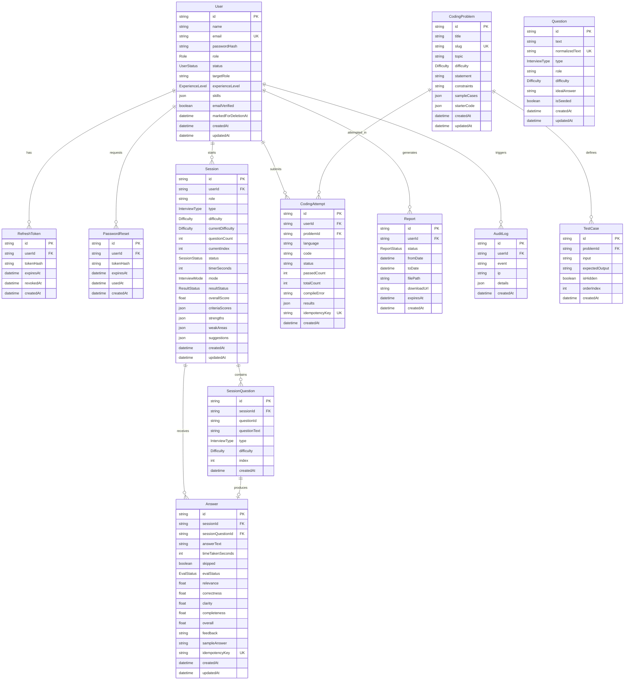

---

## 4. Detailed Component & Class Diagram

```mermaid
classDiagram
    direction TB

    class AuthService {
        +register(RegisterInput)
        +sendVerificationOtp(email)
        +verifyOtp(VerifyOtpInput)
        +resendOtp(email)
        +login(LoginInput, ip)
        +refreshToken(token)
        +logout(token)
        +deleteAccount(userId, input)
    }

    class InterviewService {
        +createSession(userId, input)
        +getSession(userId, sessionId)
        +submitAnswer(userId, sessionId, input, idempotencyKey)
        +processAnswerEvaluation(sessionId, sqId, answerId)
        +getAnswerEvaluation(userId, sessionId, answerId)
        +skipQuestion(userId, sessionId, questionId)
        +pauseSession(userId, sessionId)
        +resumeSession(userId, sessionId)
        +endSession(userId, sessionId)
        +getSessionResult(userId, sessionId)
    }

    class LlmService {
        +generateQuestion(params)
        +pickFallbackQuestion(role, type, difficulty, excluded)
        +evaluateAnswer(params)
        +mockEvaluateAnswer(qText, aText, idealAnswer)
        +generateSessionSummary(params)
    }

    class CodingService {
        +getTopics()
        +getProblems(userId, params)
        +getRandomProblem(userId, topic, difficulty)
        +getProblemById(idOrSlug, userId)
        +runCode(userId, problemId, input)
        +submitCode(userId, problemId, input, idempotencyKey)
    }

    class CodeRunnerService {
        +runBatch(language, code, cases)
        -checkJudge0()
        -runOnJudge0(language, code, cases)
        -runInIsolatedSandbox(language, code, cases)
        -executeProcess(cmd, args, input, timeoutMs)
    }

    class DashboardService {
        +getSummary(userId, from, to)
        +getTrend(userId, from, to, granularity)
    }

    class PdfReportService {
        +queueReport(userId, from, to)
        +generatePdf(reportId)
        +getReportStream(reportId, userId)
    }

    class AdminService {
        +getStats()
        +getQuestions(params)
        +createQuestion(input, adminId, ip)
        +updateQuestion(id, input, adminId, ip)
        +deleteQuestion(id, adminId, ip)
        +bulkUploadQuestions(csvContent, adminId, ip)
        +updateUserStatus(userId, status, adminId, ip)
        +getAuditLogs(params)
    }

    InterviewService --> LlmService : invokes
    CodingService --> CodeRunnerService : delegates execution
    InterviewService --> PrismaClient : reads/writes
    AuthService --> RedisClient : manages OTP & lockouts
    AuthService --> PrismaClient : manages users
    AdminService --> PrismaClient : manages repository
    PdfReportService --> PrismaClient : compiles data
```

---

## 5. Sequence Diagram 1: Registration & OTP Verification Flow

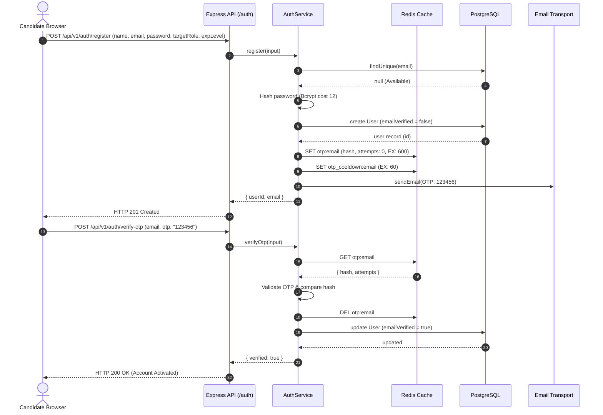

---

## 6. Sequence Diagram 2: Candidate Login & Sliding Refresh Token Rotation

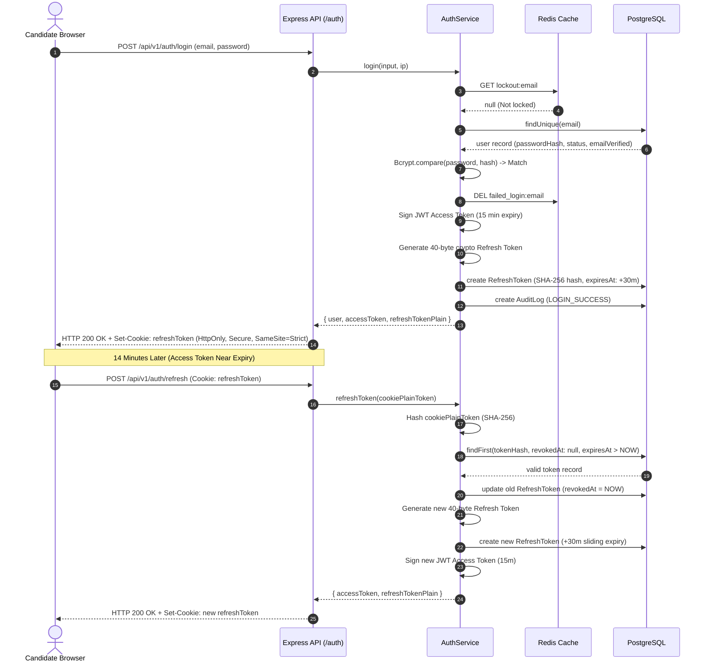

---

## 7. Sequence Diagram 3: Adaptive Interview Session Lifecycle & Evaluation

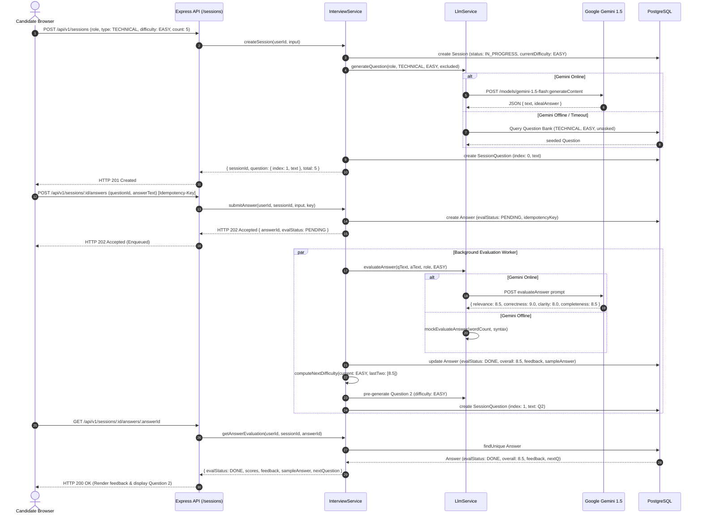

---

## 8. Sequence Diagram 4: Coding Sandbox Execution Pipeline (Judge0 vs Local Sandbox)

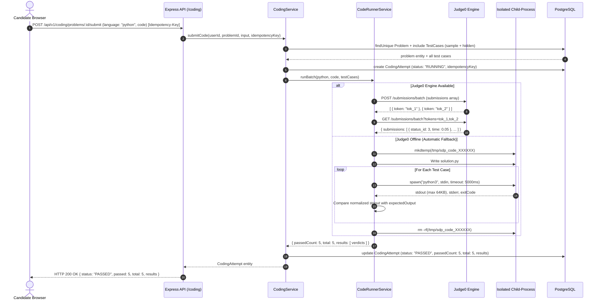

---

## 9. Sequence Diagram 5: PDF Readiness Report Generation & Download

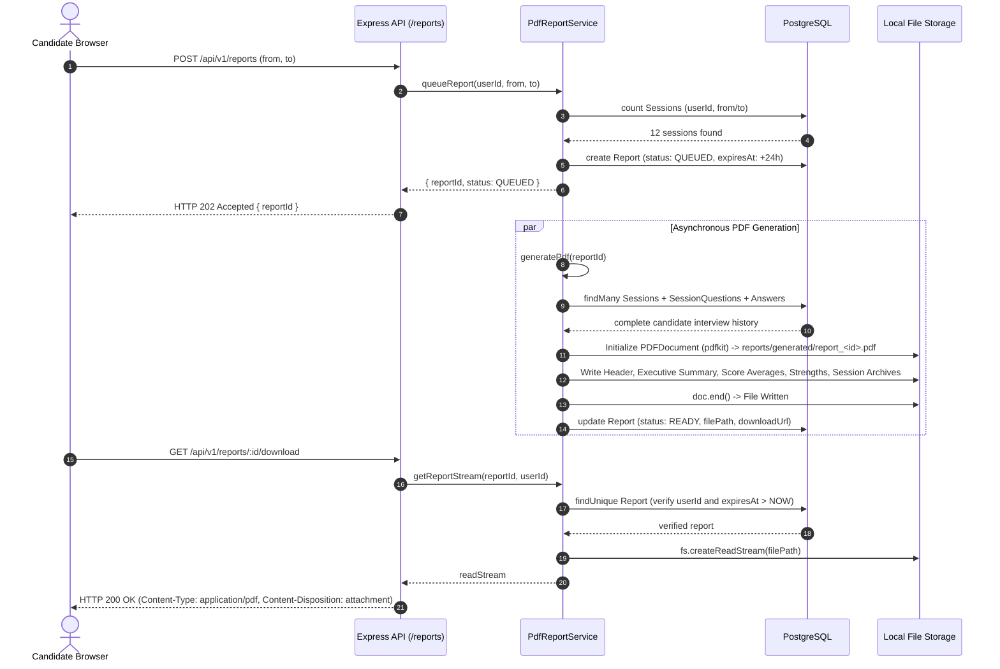

---

## 10. Sequence Diagram 6: Admin Bulk CSV Question Ingestion Flow

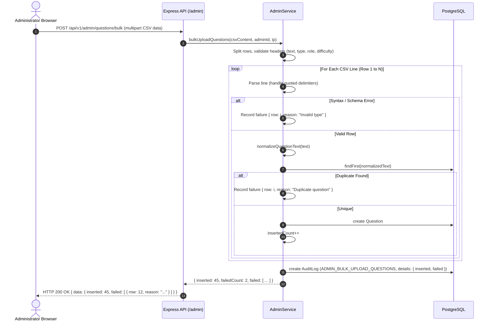

---

## 11. State Machine Diagram: Interview Session State Lifecycle

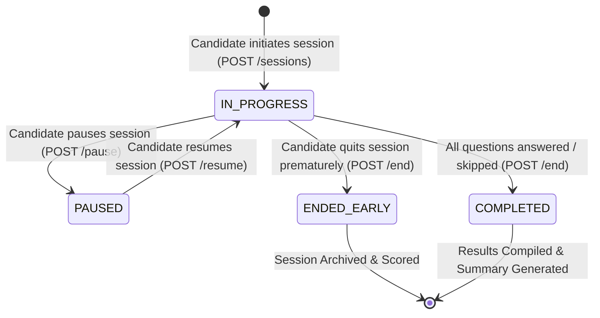

---

## 12. State Machine Diagram: User Account Status & GDPR Lifecycle

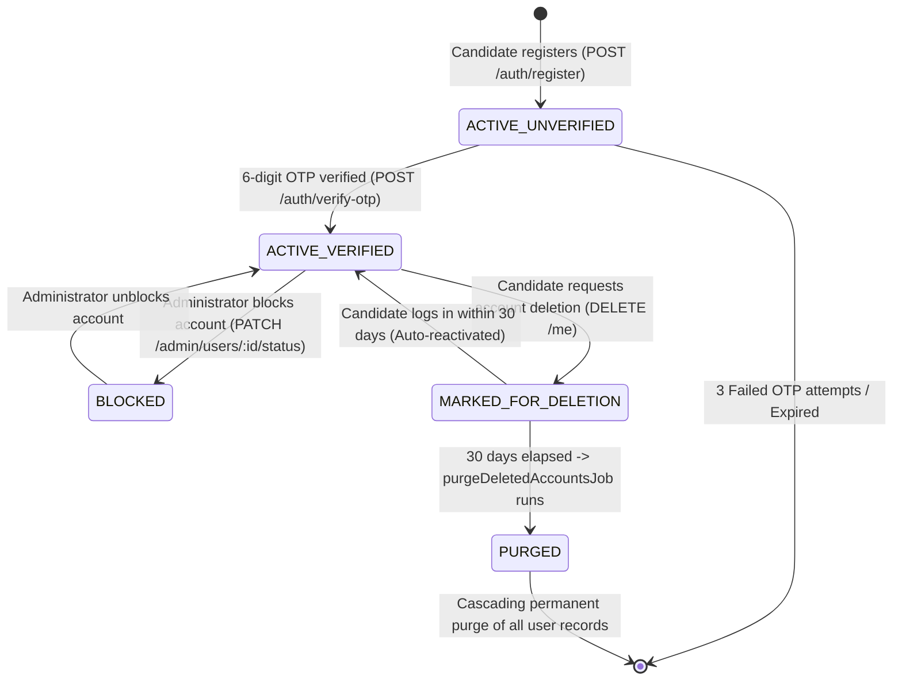

---

## 13. State Machine Diagram: Coding Attempt Verdict State Machine

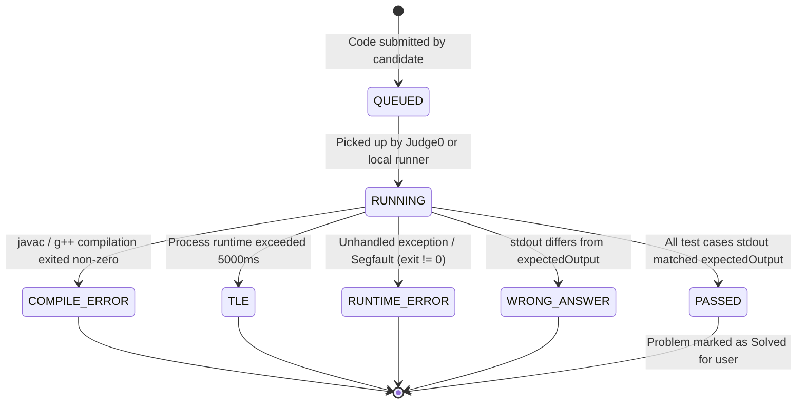

---

## 14. Activity Diagram: Candidate Adaptive Mock Interview Execution

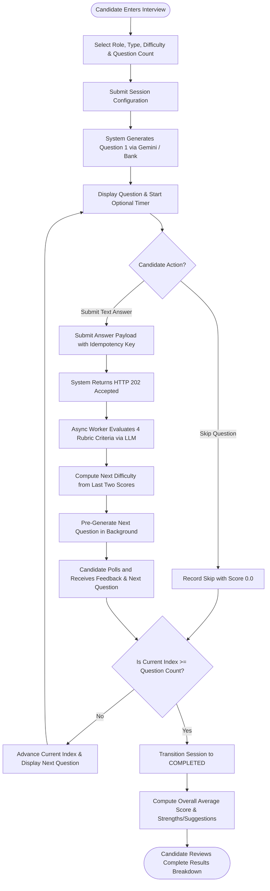

---

## 15. Activity Diagram: Sandboxed Code Execution & Security Pipeline

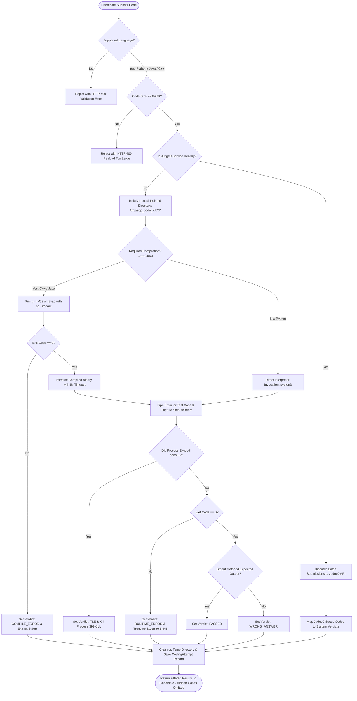

---

## 16. Deployment Diagram: Container Topology & Infrastructure

```mermaid
deploymentDiagram
    node "Production Host / VM (Ubuntu Linux 22.04 LTS)" {
        node "Docker Engine" {
            node "Container: sdp_web" {
                artifact "Next.js 14 App Router" as WebApp
                note right of WebApp: Port 3000 (Internal / Reverse Proxy)
            }

            node "Container: sdp_api" {
                artifact "Node.js Express REST API" as ApiApp
                artifact "PDFKit Stream Engine" as PDFEngine
                artifact "Isolated Runner (child_process)" as LocalRunner
                note right of ApiApp: Port 4001 (Internal / Reverse Proxy)
            }

            node "Container: sdp_postgres" {
                database "PostgreSQL 16 Server" as PGServer
                note right of PGServer: Port 5435 (Host) -> 5432 (Internal)
            }

            node "Container: sdp_redis" {
                database "Redis 7 Server" as RedisSvc
                note right of RedisSvc: Port 6385 (Host) -> 6379 (Internal)
            }

            node "Docker Volumes" {
                storage "sdp_postgres_data" as PGVolume
                storage "sdp_redis_data" as RedisVolume
                storage "reports/generated" as ReportsVolume
            }
        }
    }

    cloud "Third-Party Cloud Services" {
        node "Google Cloud" {
            artifact "Gemini 1.5 Flash API" as GeminiSvc
        }
        node "Judge0 Host / Cluster" {
            artifact "Judge0 Batch API" as Judge0Cluster
        }
        node "Email Relay" {
            artifact "SMTP Mail Relay" as SmtpSvc
        }
    }

    WebApp -->|HTTP / API Requests| ApiApp
    ApiApp -->|TCP: 5432| PGServer
    ApiApp -->|TCP: 6379| RedisSvc
    ApiApp -->|HTTPS REST| GeminiSvc
    ApiApp -->|HTTP REST| Judge0Cluster
    ApiApp -->|SMTP: 587| SmtpSvc

    PGServer --> PGVolume : mounts
    RedisSvc --> RedisVolume : mounts
    ApiApp --> ReportsVolume : stores generated PDFs
```
